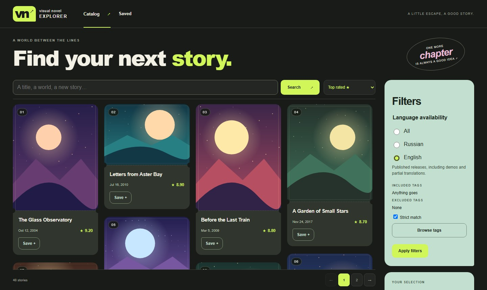

# VN Explorer

**Find your next visual novel.** Browse by title, language, and tags, see what editions are available, and keep a list of stories you want to read.

📦 [Download the latest release](https://github.com/GrigoryevaEva/VNExplorer/releases/latest)

<!-- Add the link to the live site here after deployment. -->



_Catalog preview with fictional titles and sample covers._

## Find, explore, and save

### 🔎 Find a story

The Catalog starts with top-rated stories. Search by title with **Enter** or **Search**, or sort by rating or first release. The Catalog shows the result count and lets you jump to a numbered page.

- Filter by English or Russian availability. Results can include published demos and partial translations.
- Browse tag sections or search the full directory. Include the themes you want and exclude the ones you want to skip. **Strict match** requires every included tag. With it off, any included tag can match, and all exclusions still apply.
- Select **Done** to close the tag picker and **Apply filters** to update the results. You can share the URL with its filters and page number. Browser Back takes you to your previous place in the Catalog.

### 📖 Explore the details

Open a story to see its rating, first release date, approximate play time, description, alternative titles, and spoiler-free tags. Browse screenshots with keyboard or touch controls. Screenshot artwork can contain spoilers or mature content.

Expand a language group to load its editions, including planned releases. Release rows show source-reported demos, partial releases, patches, and machine translation where available.

### 🔖 Keep a reading list

Select **Save** on a card or story page. In **Saved**, search by title or sort by recently added, rating, or first release. If you remove a story by mistake, you have eight seconds to undo it.

Your list stays in the browser and survives ordinary reloads. Saved cards remain readable during a VNDB outage. Each browser profile and site address has its own list, and clearing site data removes it.

Catalog data and source artwork come from [VNDB](https://vndb.org/) through the [VNDB Kana API](https://api.vndb.org/kana). See [VNDB’s data licence](https://vndb.org/d17).

## For developers

<details>
<summary>Fork, run locally, check, and deploy</summary>

### Run locally

VN Explorer is a Vue, TypeScript, and Vite app. Use **Node.js 24** and npm.

[Fork the repository](https://github.com/GrigoryevaEva/VNExplorer/fork), then replace `YOUR-USERNAME` with your GitHub username.

```sh
git clone https://github.com/YOUR-USERNAME/VNExplorer.git
cd VNExplorer
npm ci
npm run dev
```

Open [localhost:5173](http://localhost:5173/). The `@/` alias points to `src/` in Vite, TypeScript, and Vitest.

### Checks and tests

Static checks report issues without editing files or running test suites.

| Command                | Checks                                                                      |
| ---------------------- | --------------------------------------------------------------------------- |
| `npm run lint`         | TypeScript and Vue lint rules                                               |
| `npm run lint:styles`  | CSS and Vue style rules                                                     |
| `npm run format:check` | Prettier formatting                                                         |
| `npm run typecheck`    | App, test, and script types, including the strict `typecheck:scripts` check |

Use `npm run lint:fix`, `npm run lint:styles:fix`, or `npm run format` to apply fixes. Running a native TypeScript script skips type checking.

Follow the repository’s review and testing workflow before running test suites or triggering CI. [Branch and testing policy](.changeset/README.md#branches-and-testing)

| Command                   | Coverage                                                                                                                                                                                                                   |
| ------------------------- | -------------------------------------------------------------------------------------------------------------------------------------------------------------------------------------------------------------------------- |
| `npm run test:unit`       | Vitest. Unit tests use Node and component tests opt into jsdom. Use `npm run test:unit:watch` for watch mode.                                                                                                              |
| `npm run test:automation` | Release CLIs in temporary Git repositories and live-process cleanup without calling VNDB                                                                                                                                   |
| `npm run test:e2e`        | Playwright browser tests. Install Chromium first with `npx playwright install chromium`.                                                                                                                                   |
| `npm run test:static`     | Builds and serves the generated files with an SPA fallback. Checks the root and `/novels/` builds, direct links, refreshes, assets, and the Catalog → detail → gallery/releases → Saved → Catalog flow with HTTP fixtures. |
| `npm run test:production` | Runs the same smoke checks using an existing `dist/` and builds the subpath fixture.                                                                                                                                       |

Static smoke screenshots go to `test-results/static-handoff/`. Set `SMOKE_ARTIFACT_DIR` to use a different directory.

**Live checks.** `npm run test:live` makes a small real-browser check against VNDB. `npm run test:handoff-live` also records evidence for title aliases, pages, counts, and details. Each of the six live commands uses the same limits of 24 requests, 120 seconds for the browser, and 10 seconds for startup. Tag probes request two small pages. Run these separately from the repeatable suite, since they depend on VNDB availability and rate limits.

### Build and deploy

**Domain root.** Build the app and copy the **contents** of `dist/`, including `assets/`, to the static document root.

```sh
npm ci
npm run build
```

Node and npm are needed at build time only. Use `npm run preview` to inspect the build locally.

Application routes such as `/vn/v17` and `/saved` must return `index.html` with status 200. Serve existing assets with their correct MIME types and return 404 for missing assets. For example, add these directives to an existing Nginx server block.

```nginx
root /srv/www/vn-explorer;
location /assets/ { try_files $uri =404; }
location / { try_files $uri $uri/ /index.html; }
```

**Subpath.** Set the build base to the exact path, including a trailing slash.

```sh
npm run build -- --base=/novels/
```

For this example, copy the contents of `dist/` into `/srv/www/novels/` and configure the matching fallback.

```nginx
root /srv/www;
location = /novels { return 308 /novels/; }
location /novels/assets/ { try_files $uri =404; }
location /novels/ { try_files $uri $uri/ /novels/index.html; }
```

**After deployment**

- Open and refresh a detail URL and Saved directly, then check browser Back from a story reached through the Catalog.
- Confirm that real browser POST requests to `https://api.vndb.org/kana/` succeed from the deployed origin. The local development origin has its own CORS behavior.
- If the host uses a Content Security Policy, allow connections to the API and loads from the image origins returned by VNDB.
- Keep attribution for the source data and artwork. [VNDB data licence](https://vndb.org/d17)

### Browser storage and data

| Data                                                   | Where it lives                  | Lifetime                                                                   |
| ------------------------------------------------------ | ------------------------------- | -------------------------------------------------------------------------- |
| Saved IDs, addition times, and last-known card details | Versioned `localStorage` record | Until removed or site data is cleared, subject to browser storage policies |
| Catalog, search, and count responses                   | IndexedDB                       | Fresh for 5 minutes                                                        |
| Detail and release responses                           | IndexedDB                       | Fresh for 6 hours                                                          |
| Tag responses                                          | IndexedDB                       | Fresh for 7 days                                                           |

Saved surfaces write failures. It has no accounts, cross-device sync, reading statuses, personal ratings, notes, folders, or import/export. Private browsing can affect persistence. Clearing the response cache leaves Saved intact.

The app reuses fresh responses and shares identical in-flight requests. During a temporary API failure, it shows a marked stale response when available or an error with a retry action. A first visit or images may still require a network connection. Browser requests depend on VNDB availability, CORS, and rate limits.

Tag sections use stable source IDs. **All tags** includes unassigned entries. Machine-translation labels appear on release rows, and the Catalog currently has no dedicated machine-translation filter.

### Versioning

Start branches from current `dev` and add a changeset with `npm run changeset` before merging back. Release preparation applies the pending notes to the version and changelog. Pushing an annotated `vX.Y.Z` tag publishes a GitHub Release with a static-site ZIP. [Changeset format and release commands](.changeset/README.md)

</details>
